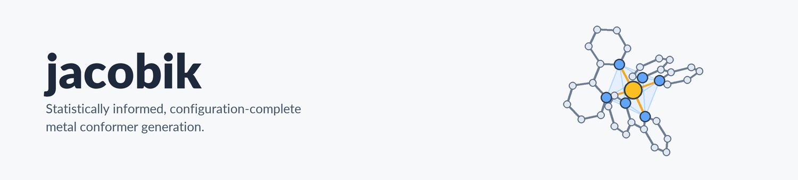

<p align="center">
  
</p>

<p align="center">
  <a href="pyproject.toml"></a>
  <a href="LICENSE"></a>
  <a href="PERFORMANCE.md"></a>
</p>

<p align="center">
  <a href="#install">Install</a> ·
  <a href="#builds">Builds</a> ·
  <a href="#quickstart">Quickstart</a> ·
  <a href="#output--options">Output &amp; Options</a> ·
  <a href="#repository">Repository</a> ·
  <a href="PERFORMANCE.md">Benchmarks</a> ·
  <a href="ARCHITECTURE.md">Architecture</a> ·
  <a href="#license">License</a>
</p>

**Jacobik** generates configuration-complete 3D conformer ensembles for transition-metal and lanthanide complexes from a metal, formal charge, spin, coordination geometry, and ligand SMILES + donor atoms:

1. **Enumerate configurations** — donor-to-site assignments, stereocentres (including metal-binding-induced chirality), and `E`/`Z` double bonds.
2. **Joint batched inverse kinematics** — optimises ligand torsions, ring puckers, and backbone bond-angle bends together (CPU or CUDA).
3. **Statistical crystal ranking** — scores structures with log-likelihoods fitted to `tmQM` and `lnQM`, with no force field in the solve loop.
4. **Settle** — ten batched MACE-POLAR steps with the declared donors held; rows are returned at the settled geometry and ordered by settled energy within each class.

> [!NOTE]
> Settled rows are not converged minima. Relax them (`relax="normal"`, see [Relaxation](#relaxation)) or with another energy model before quantitative energetic comparison across classes.

---

## Install

**pixi (recommended)** — pins Python 3.11, PyTorch with CUDA, RDKit, and `xtb`:

```bash
pixi install -e linux
export PATH="$PWD/.pixi/envs/linux/bin:$PATH"
```

**pip + conda-forge** — `xtb` (`6.7.1 <= version < 7`) is required on `PATH` (or `JACOBIK_XTB`) for GFN2 ligand refinement:

```bash
conda install -c conda-forge "xtb>=6.7.1,<7"
pip install -r requirements.txt && pip install -e .
```

| Requirement | Role & Default |
|---|---|
| `xtb` on `PATH` | Mandatory for GFN2 ligand embed refinement (missing `xtb` falls back to invalid MMFF embeds). Verify with `jacobik check`. |
| Statistics DB | `src/jacobik/data/constraints_2026-11-12.npz` (~28 MB, self-describing) ships packaged and loads automatically. Override via `constraints_db=`, `--db`, or `JACOBIK_DB`, or rebuild with `python -m fit.build_db`. |
| MACE-POLAR (`.[mace]`, in `requirements.txt`) | Embed refinement, settle and relaxation. The MACE-POLAR-1-S weights (Academic Software License, non-commercial) are not part of the repository: they are downloaded from the official `ACEsuit/mace-foundations` release into `~/.cache/mace` on first use; `JACOBIK_MACE_MODEL_PATH` uses a local copy. Without the `mace` extra the generator falls back to GFN2 refinement and unsettled rows, with a warning. |
| Hardware | Runs on CPU or CUDA (`device="cuda"` / `--device auto`); see [Builds](#builds) for the GPU build. |

### Builds

Jacobik ships as two builds of the same release, with the same API, statistics DB and profile fingerprint (`jacobik fingerprint`). Both install as the `jacobik` package, so install one. They are two branches of this repository:

| Build | Branch | Tag | Runs on | When to use |
|---|---|---|---|---|
| PyTorch (portable) | `master` | `v1.0b` | CPU, or any CUDA GPU through PyTorch | Default; CPU-only machines, CPU clusters, Windows |
| GPU (CuPy + Triton kernels, no PyTorch needed) | `master-triton` | `v1.0b-gpu` | Linux with an NVIDIA GPU (CUDA 12); no CPU path | Throughput: about 6x faster per complex than the PyTorch build on an A100 |

```bash
git clone <repository-url> && cd jacobik && pixi install -e linux                          # PyTorch build (master)
git clone --branch master-triton <repository-url> && cd jacobik && pixi install -e linux   # GPU build
python -c "import jacobik; print(jacobik.__version__, jacobik.BUILD)"
```

The two builds agree within the confidence intervals of the benchmark (`PERFORMANCE.md`); individual rows can differ because the GPU kernels reduce in a different order.

---

## Quickstart

### Python API

Use library aliases/binding modes (`bpy*3`, `dmso@kappa1_O`), unpackable debug complexes (`DEBUG_COMPLEX_CBTYCO`, `DEBUG_COMPLEX_OJIMIF`), or explicit `LigandInput(smiles, donors)` definitions:

```python
import jacobik
from jacobik import ComplexBuilder, LigandInput
from interface.ligand_library import DEBUG_COMPLEX_CBTYCO, ligand

# Library aliases, binding modes, or predefined debug complexes
res = jacobik.generate("Fe", "octahedral", 2, 1, ligands=["bpy*3"], seed=11)
res = jacobik.generate(*DEBUG_COMPLEX_CBTYCO)
res = jacobik.generate("Pt", "square_plan", 0, 1, ligands=["en", "dmso@kappa1_O", ligand("isothiocyanate")])

# Arbitrary SMILES: inner lists define coordination points (e.g. hexadentate EDTA, haptic Cp [[0,1,2,3,4]])
edta = LigandInput("[O-]C(=O)CN(CC(=O)[O-])CCN(CC(=O)[O-])CC(=O)[O-]", donors=[[0], [4], [8], [11], [15], [19]])
res = ComplexBuilder("Co", "octahedral", charge=-1, spin=1, ligands=[edta]).solve(seed=11, device="cpu")

res.summary()
res.best.write_xyz("co_edta_top.xyz")
```

Supported geometries: `linear`, `trigonal`, `t_shaped`, `square_plan`, `tetrahedral`, `see_saw`, `square_pyr`, `trig_bipyr`, `octahedral`, `trig_pris`, `pent_bipyr`, `square_anti`, `tricap_pris`, and `other`. Pass `LigandInput(..., sites=[...])` to pin donors to explicit site indices (`jacobik.geometry_sites(geom)`).

### Command Line

Installed as `jacobik` (also runnable directly via `python interface/jacobik_cli.py`):

```bash
jacobik check                                     # verify xtb binary, packaged DB, and compute device
jacobik fingerprint                               # print active production profile hash
jacobik ligands                                   # list curated ligands, binding modes, and debug complexes
jacobik ligands dmso                              # inspect modes and aliases for a ligand

jacobik solve --metal Fe --geometry octahedral --charge 2 --spin 1 --ligand "bpy*3" --out fe_bpy3.xyz --by-class
jacobik solve --debug-complex CBTYCO --out-dir ./output --n-conformers 3
jacobik solve --dataset ./data_custom --split user --out-dir ./output --n-conformers 3
```

Interactive notebooks: [`interface/run_solver.ipynb`](interface/run_solver.ipynb) and [`interface/prepare_data.ipynb`](interface/prepare_data.ipynb).

---

## Output & Options

A **class** groups structures sharing one configuration (donor-site assignment, stereocentres, `E`/`Z` geometry); conformers within a class are distinct 3D conformations.

```python
for cls in result.classes():                     # C1, C2, ... ranked by best score
    print(cls["class_id"], cls["geometry"], cls["stereo"], cls["n_rows"], cls["delta_nats"])

top_rows = result.by_class()[result.classes()[0]["class_label"]]
result.write_xyz("out/", by_class=True)          # out/C1.xyz, out/C2.xyz, ... (rank/score in comment line)
records = result.to_records()                    # plain dicts: rank, score, delta_nats, class_id, descriptors
```

- `delta_nats` measures log-likelihood gap below the top-ranked row (it orders rows as solved, **not** relative energy).
- Enantiomers of achiral-ligand configurations are completed by reflection (`n_reflected` in `classes()`).

| `ComplexBuilder.solve` Option | Default | Effect |
|---|---|---|
| `n_conformers` | `max(beam_width, n_coord_samples)` (16) | Maximum conformers returned (`--n-conformers`). |
| `beam_width` | `16` | Torsion seeds kept per ligand in beam search. |
| `n_ik_steps` | `200` | Joint inverse-kinematics refinement steps. |
| `n_coord_samples` | `8` | Coordination-sphere distance samples. |
| `embed` | `"gfn2"` | Free-ligand embed method: `"gfn2"`, `"mmff"`, or `"etkdg"` (`--fast-embed`). |
| `device` | `"cpu"` | `"cpu"` or `"cuda"` (CLI `--device auto`). |
| `seed`, `embed_seed` | `None`, internal | Solver seed and ligand-embed seed (`solve_multi_embed` varies embeddings). |
| `angle_bends` | `True` | Backbone bond-angle bend DOFs on chelate rings. |
| `stereo_enum`, `out_per_class` | profile | Enumerate stereo classes; keep up to `out_per_class_k` (`8`) rows per class. |
| `use_symmetry_enumeration`, `embed_aware_dedup` | `True` | Symmetry-distinct site enumeration merged only by true embedded ligand symmetry. |
| `constraints_db`, `stats` | packaged DB | Custom `.npz` path or pre-loaded `StatsLookup`. |
| `settle_steps` | `10` | MACE-POLAR settle steps after the solve (`0` returns the solver rows as scored). |
| `settle_top` | all rows | Settle and return only the `k` lowest-energy rows of each class (`--settle-top`). |

### Relaxation

`generate(..., relax="normal")` (or `result.relax(level="normal")`, CLI `--relax normal`) relaxes every returned row with MACE-POLAR in batches on the solve device:

| Option | Default | Effect |
|---|---|---|
| `relax` / `level` | off | `"loose"`, `"normal"` or `"tight"` force criterion. |
| `relax_top` | all rows | Relax and return only the `k` best-ranked rows of each class (`--relax-top`). |
| `relax_binding` | `"keep"` | `"keep"` relaxes inside the requested binding mode and flags rows held there; `"free"` is unconstrained and reports metal-contact changes. |
| `relax_etol` | off | Also stop a row once its energy fell by less than `etol` kJ/mol over 5 evaluations: energies to about `etol` without the long tail of small force steps (`--relax-etol`). |
| `rerank` | `False` | Order rows by relaxed energy within each class (`--relax-rerank`). |

Output deduplication keeps structures with heavy-atom symmetric RMSD above **0.5 A** (`dedup_rmsd`) within a **200 nat** window (`out_window`). Override profile settings before import via `JACOBIK_PROFILE_OVERRIDES='{"dedup_rmsd": 0.3}'` and audit provenance with `jacobik.profile.snapshot()`.

---

## Repository

| Path | Contents |
|---|---|
| `src/jacobik/` | Generator package (`builder/`, `core/`, `topology/`, `ik/`, `stats/`, packaged `data/`) |
| `src/fit/` | Statistics database fitting pipeline (`python -m fit.build_db`) |
| `interface/` | CLI wrapper (`jacobik_cli.py`), `ligand_library.py`, dataset preparation & notebooks |

See [`ARCHITECTURE.md`](ARCHITECTURE.md) for pipeline details, [`PERFORMANCE.md`](PERFORMANCE.md) for `v1.0b` benchmarks, [`docs/CHANGELOG.md`](docs/CHANGELOG.md) for release history and [`docs/RELEASE_v1.0b.md`](docs/RELEASE_v1.0b.md) for the release notes. The maintainers' development tree (tests, golden references, benchmark and campaign tooling) is not part of this repository.

---

## License

Released under the [MIT License](LICENSE).

`tmQM` and `lnQM` datasets are used under their respective terms; `xtb` and `MACE` are external third-party tools. Citation: to be added (`CITATION.cff`).
