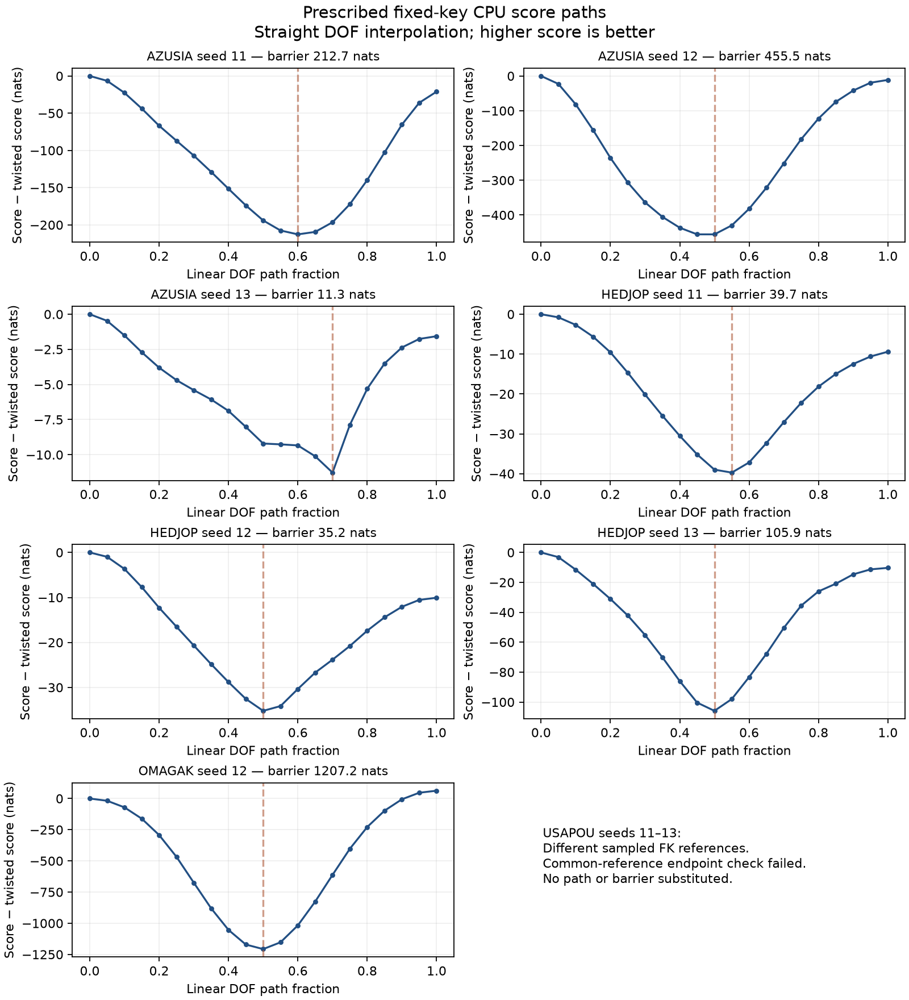

# R2s twist diagnostic — regenerated CPU states, 2026-11-02

**Result:** native gradients verified for 10/10 frozen units; complete
21-point paths for 7/10. Six twisted states meet the solver’s predicted
remaining-gain threshold; USAPOU’s three and OMAGAK do not. Every valid
path has an interior score minimum, but these straight-path barriers
do not establish a full-dimensional local maximum. The diagnostic does
not support calling all twisted rows spurious score maxima.

The three USAPOU path failures are retained: native endpoints use
different sampled macrocycle references. Direct interpolation of their
captured DOFs under one reference misses the endpoint. No alternative
partner, optimized path, score change or new arm was substituted.

## Data and verification

Original GPU exports omitted native DOFs. Coordinate-only recovery failed
the score/state checks and remains recorded in shared g3e/twist/result.json;
none of its gradients or barriers is accepted. The owner explicitly
approved CPU regeneration. These CPU rows are separately labelled and
do not replace either GPU clean24 result. Same ten parent/seed units;
native C1/R2s reference pools, one CPU worker, no culling, 250 steps.
All selection rules were frozen before native results; selected native
IDs/state hashes were committed before remaining paths. No case replaced.

Captured FK references, returned DOFs, assignments and Q3 commitments are
persisted. Every reported native role reproduces geometry <=1e-5 Å and
returned score <=1e-4 native units. All paths keep the twisted row’s
starting-shell Q2 pair keys and native Q3 commitment fixed. No current-
shape re-keying was implemented. Native score units and summed nats are
both preserved: nats = native score × scorer._agg_norm(). Gradients use
the same conversion; thermal norms use the resolved per-DOF widths.

## Native DOF gradients

| Unit | Z | Raw native ∥g∥, twisted / top-1 | Summed-nat ∥g∥, twisted / top-1 | Thermal ∥gσ∥, twisted / top-1 | ½∥gσ∥² <0.1 |
|---|---:|---|---|---|---|
| AZUSIA s11 | 31 | 0.0851 / 0.0770 | 2.6385 / 2.3874 | 0.4201 / 0.3493 | yes |
| AZUSIA s12 | 31 | 0.1115 / 0.0848 | 3.4559 / 2.6301 | 0.4397 / 0.4187 | yes |
| AZUSIA s13 | 31 | 0.0690 / 0.0916 | 2.1376 / 2.8398 | 0.4451 / 0.4418 | yes |
| USAPOU s11 | 34 | 0.7247 / 0.7218 | 24.6404 / 24.5399 | 5.1265 / 5.4110 | no |
| USAPOU s12 | 34 | 0.7937 / 1.0502 | 26.9857 / 35.7053 | 5.6285 / 8.4792 | no |
| USAPOU s13 | 34 | 1.6748 / 0.6852 | 56.9447 / 23.2973 | 12.7544 / 5.1651 | no |
| HEDJOP s11 | 44 | 0.0866 / 0.0866 | 3.8111 / 3.8111 | 0.4302 / 0.4302 | yes |
| HEDJOP s12 | 44 | 0.0818 / 0.0818 | 3.6002 / 3.6002 | 0.3315 / 0.3315 | yes |
| HEDJOP s13 | 44 | 0.1031 / 0.1031 | 4.5383 / 4.5383 | 0.3846 / 0.3846 | yes |
| OMAGAK s12 | 31 | 0.7499 / 0.2283 | 23.2463 / 7.0768 | 3.0013 / 0.8586 | no |

HEDJOP’s selected twisted row is also its regenerated R2s unit top-1 in
all three seeds; the equal norms are the same point, not independent
samples. The remaining-gain flag is descriptive, using the existing
criterion; finite gradients and one-dimensional paths are not Hessian
certificates of local maximality.

## Prescribed score barriers and CPU MACE

Barrier = twisted score minus the minimum of 21 equally spaced linear
DOF path points. Equivalent angular branches and rigid global alignment
are fixed before interpolation; bend DOFs keep native values. All valid
minima are interior. MACE polar-1-s float64, CPU only, no relaxation.
Energy differences below use the same CPU model for all points.

| Unit | Barrier (nats) | Untwisted − twisted score (nats) | E(twisted) − E(untwisted), kJ/mol | E(path minimum) − E(twisted), kJ/mol | Largest score-drop terms (nats) |
|---|---:|---:|---:|---:|---|
| AZUSIA s11 | 212.712 | -21.048 | -45.357 | 3204.670 | Q1: 84.93, Q2: 38.72, Q6: 34.20 |
| AZUSIA s12 | 455.526 | -11.333 | -33.198 | 1887.836 | Q1: 201.24, Q6: 86.39, Q3: 85.26 |
| AZUSIA s13 | 11.272 | -1.566 | -6.816 | 12.819 | Q3: 7.05, Q5: 3.49, Q2: 0.61 |
| USAPOU s11 | unavailable | unavailable | -62.171 | unavailable | common-reference endpoint failure |
| USAPOU s12 | unavailable | unavailable | -16.737 | unavailable | common-reference endpoint failure |
| USAPOU s13 | unavailable | unavailable | 66.312 | unavailable | common-reference endpoint failure |
| HEDJOP s11 | 39.715 | -9.395 | -283.553 | 181.609 | Q5: 26.50, Q1: 6.59, Q6: 4.74 |
| HEDJOP s12 | 35.203 | -10.062 | -289.447 | 121.884 | Q5: 22.75, Q6: 5.96, Q1: 3.40 |
| HEDJOP s13 | 105.870 | -10.283 | -269.442 | 1021.646 | Q5: 60.59, Q6: 24.77, Q1: 17.58 |
| OMAGAK s12 | 1207.167 | 62.930 | 353.120 | 15687.497 | Q1: 656.55, Q6: 522.90, Q2: 13.90 |

CPU MACE favors the selected twisted endpoint over its proximity-selected untwisted partner in 8/10 pairs.
Partners were selected by geometry/assignment, not energy. These pairs
do not establish that the untwisted endpoint is the better physical
basin; they also do not establish global quality of the twisted pool.
Large MACE increases and Q1/Q6 drops at some linear-path minima show
that the prescribed interpolation passes through strained/clashing
structures. The path is not a minimum-barrier transition path.

Q1/Q6 dominate several barriers, Q5 dominates HEDJOP, and Q3 dominates
AZUSIA seed 13. Q2 is not the sole source. Full Q1–Q7, bend-prior and
seam terms at all 21 points are in each raw path.json. Q7 is zero when
the Cartesian Q7 term is inactive; the native DOF bend prior is listed
separately and included in totals.

## USAPOU reference limitation

| Seed | Own-reference aligned RMSD (Å) | Twisted-reference endpoint RMSD (Å) | Macrocycle DOFs |
|---|---:|---:|---|
| 11 | 5.21e-15 | 2.165832 | [0, 5, 0] |
| 12 | 7.96e-15 | 1.995434 | [0, 5, 0] |
| 13 | 6.41e-15 | 2.299598 | [0, 5, 0] |

The own-reference rotation checks are at numerical precision, while the
common-reference endpoint misses by about 2 Å. USAPOU has row-dependent
sampled references and five macrocycle torsions. This instrument did not
construct a common-reference path for the frozen nearest partners. It
does not prove that no such path exists. Gradients and both endpoint
MACE energies are still reported for all three units.

## Interpretation and scope

Six rows show small predicted remaining gain plus score barriers along
the prescribed fixed-key line: evidence of nearly settled score basins
under the starting-shell model. A full-dimensional local-maximum claim
would require more than this path. Four rows have larger gradients and
cannot be classified as settled maxima by this criterion. The selected
endpoint MACE comparisons often favor the twisted state, so “spurious”
is not established by these pairs. No score change follows from this
descriptive diagnostic. R2s remains built and off, reserved for the
hypothesis layer; current-shape pair-key adaptation remains future work.

G3E_TWIST_RESULT.json contains all native gradient observations, path
summaries, exact term drops and raw-state SHA256s. Full native pools,
DOFs/references, 21-point series, MACE values and verification failures
remain in shared research/data/jgen/campaign/B/g3e/. No GPU was used by
this CPU diagnostic; Colab spend zero.
